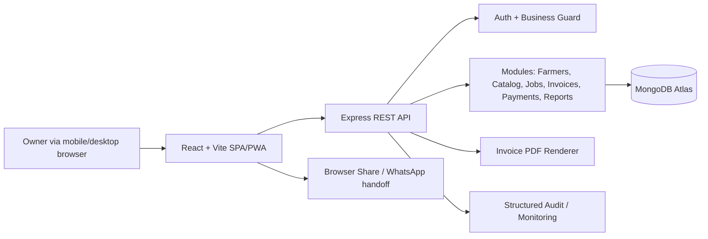

# HLD — High-Level Design

## 1. Overview
Modular monolith MERN application: React PWA frontend, Node.js/Express REST backend, MongoDB Atlas. A modular monolith keeps early development and financial consistency simpler than microservices. APIs are versioned `/api/v1`.

## 2. Technology choices
| Concern | Choice | Rationale |
|---|---|---|
| Frontend | React + TypeScript + Vite | Strong composability, safer money/data types |
| CSS | Tailwind CSS + design tokens | Consistent SaaS look and mobile layouts |
| Routing | React Router | Nested app routes, deep links |
| Data cache | TanStack Query | Query invalidation and loading states |
| Forms | React Hook Form + Zod | Predictable validation and multi-step wizard |
| Charts | Recharts | Accessible reports + table fallback |
| Translations | react-i18next | Telugu/Hindi/English |
| Backend | Node.js + Express + TypeScript | Shared ecosystem and schema discipline |
| Database | MongoDB + Mongoose | Per-business documents, transactions and indexes |
| PDF | Puppeteer (server-rendered HTML) or PDFKit | Controlled invoice generation |
| Auth | HttpOnly secure cookies with short-lived sessions/tokens, Argon2id password hashing | Limit token leakage; CSRF protections as required |
| Testing | Vitest, React Testing Library, Supertest, Playwright | Unit, API and end-to-end |
| Deployment | Static frontend + containerized API + managed MongoDB | Independent scaling, easy monitoring |

## 3. Backend modules and boundaries
- `auth`: login/session, password reset; tenant/business context.
- `farmers`: create/edit/search farmer identities; never calculates invoice totals locally.
- `catalog`: equipment, service definitions, pricing defaults and packages.
- `jobs`: recording work, storing immutable pricing snapshot on completion.
- `invoices`: numbering, snapshots, issued/void lifecycle, PDF generation.
- `payments`: receipts, reversals, allocations, due status.
- `reports`: read aggregations derived from jobs, invoices, receipts.
- `audit`: entity and financial mutation trail.

## 4. Data ownership
Each collection includes `businessId`. Every request obtains it from authenticated context, never request body. Query filters enforce `businessId`; indexes start with `businessId`. No cross-business joins exposed through endpoints.

## 5. Financial consistency
Amounts stored integer paise. A posted payment uses transactional update of receipt + allocation + invoice paid snapshot (or transactionally maintained ledger view). Unique `(businessId,idempotencyKey)` prevents network retries creating extra records. Issued invoice line items are immutable; payment reversals produce compensating entries. API is authoritative for totals.

## 6. Reports
Separate metrics:
- Work value: sum of finalized, nonvoid service lines by work completion date.
- Collections: sum of posted nonreversed receipts by receipt date.
- Current outstanding: sum of invoice open balances as of report cutoff; don't calculate as `selected work value - selected collections` for arbitrary periods.
- Equipment attribution: sum of job lines explicitly assigned to equipment/service; mixed invoices apportioned by line's unpaid share or explicit allocations, never duplicate whole invoice per tool.

## 7. Offline strategy
MVP is **online-first** with mobile responsive site and installable PWA optional. Offline reading/cache may be added before offline financial writes. Next release: Dexie/IndexedDB write queue, client-generated UUIDs, unique idempotency keys, sync states (`LOCAL`, `PENDING`, `SYNCED`, `FAILED`, `CONFLICT`); test crashes and duplicate reconnects. Never claim save complete if server hasn't acknowledged.

## 8. External integrations
- WhatsApp: MVP user-initiated share of PDF/download link; do not promise automated unsolicited messaging.
- PDF: server route renders consistent invoice template; archived issued PDF hash and version recommended.
- SMS/WhatsApp Business API: Next release, consent-based and with provider terms/fees verified.

## 9. Environments
`local`, `staging`, `production`; separate MongoDB projects/databases and secrets; HTTPS; secrets never shipped to frontend. Automatic backups and restore drill before production. App/API request and error IDs for tracing.

## 10. Observability
Log route, request ID, business ID pseudonymous identifier, operation, latency, error type; **never** raw phone, payment notes, passwords, credentials or complete invoices. Metrics: HTTP error rates, invoice creation conflicts, duplicate-retry suppression, transaction rollback count, PDF failures.

## 11. Scale assumptions
Initial single-region deployment in India with tens–hundreds of machinery owners; pagination for large farmer/job lists. If scale differs, revisit indexes and worker processing after real load measurements.
