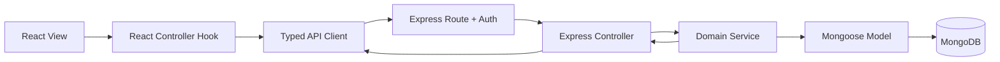
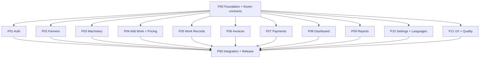

# Kisan Machinery Manager — Independent Phase-wise MERN Development Plan (MVC)

> **Document:** `MVC_PHASEWISE_DEVELOPMENT_PLAN.md`  
> **Version:** 1.0 · **Status:** Development baseline · **Project:** Kisan Machinery Manager (working brand; can be renamed later)  
> **Architecture:** Modular monolith · MERN · MVC · Contract-first feature development  
> **Audience:** Developer and AI coding assistants

---

## 1. Objective

Build a **mobile-first, multilingual, visual agricultural machinery business SaaS** for owners of tractors, rotavators, ploughs, trolleys, harvesters and other equipment. Record farmer details, jobs charged by hour/acre/trip or custom price, issue bills, collect full/partial payments, and find unpaid amounts by farmer and machinery.

**Primary instruction:** Implement the product as **independently developable, independently testable feature phases**. A phase must not require the code of another unfinished feature to build or pass its tests. When it needs information normally owned by another feature, use a **versioned interface and a mock/fixture implementation** until integration.

**Important distinction:** Completely *zero-dependency* business functionality is impossible: a real invoice refers to a job; a real payment refers to an invoice. We will eliminate **development-time blocking dependencies**, not pretend the domain relationships do not exist. A single small shared foundation and frozen contracts are prerequisites. Actual feature wiring happens in one controlled integration phase.

### Product boundaries

- **MVP:** owner account; farmers; machinery/services and default pricing; new work and work records; bills and PDF; partial payments; farmer/equipment-wise dues; business dashboard; detailed reports; English/Telugu/Hindi UI; responsive accessibility.
- **Post-MVP:** offline financial writes/sync, voice entry, automated WhatsApp/SMS reminders, expenses and maintenance, employees and farmer logins, payment gateway.
- **Not in MVP:** machinery rental marketplace, loans, GPS fleet tracking, GST tax engine and automatic payment settlement.

### Source-of-truth references

This plan complements the existing documentation pack rather than replacing its definitions:

- `docs/01-product/PRD.md`
- `docs/02-design/DESIGN_MDR.md`
- `docs/02-design/SCREEN_SPEC.md`
- `docs/03-architecture/HLD.md`
- `docs/03-architecture/LLD.md`
- `docs/03-architecture/DATABASE.md`
- `docs/03-architecture/API.md`
- `docs/AGENTS.md` (or root `AGENTS.md`)

If documents disagree, **record the conflict in `DECISIONS.md` and resolve it before modifying a financial contract**. No AI agent may silently choose its own payment model.

---

## 2. Architecture decision: MVC in a MERN application

Use **one modular monolith**, not microservices. Backend remains an Express REST API. React supplies the user-facing **Views**. Express **Controllers** receive requests, while Mongoose **Models** own persistence. Small **Services** hold business rules so that financial logic does not become buried in controllers.

### MVC responsibility matrix

| Layer | Responsibility | Must NOT do |
|---|---|---|
| **Model (M)** | MongoDB/Mongoose schemas, indexes, validations, persistence | Render UI or decide navigation |
| **View (V)** | React pages, cards, tables, forms, accessibility, translations | Query MongoDB, calculate authoritative balances |
| **Controller (C)** | Handle request, validate input, call service, send response; frontend hooks connect Views to APIs | Own complex pricing/payment math or write another feature's collection |
| **Service (supporting MVC)** | Price calculations, job finalization, invoice numbering, payment transactions, report aggregation | Bypass authorization and contract validation |
| **Route** | HTTP endpoints and middleware composition | Contain business rules |
| **Repository (optional)** | Reusable, tenant-scoped model queries | Change financial status without service rules |

**End-to-end flow**:



**Rule:** The frontend must never connect directly to MongoDB. The server is authoritative for bill amounts, balances, permissions and receipt posting.

---

## 3. Recommended project file structure — explicit MVC

The root structure intentionally makes **Models, Views and Controllers visible** to a developer or AI assistant. `modules/` is not required; the feature owner is expressed in each file name and its corresponding service. This is straightforward MVC rather than forcing backend HTML templates into an API-only server.

```text
kisan-machinery-manager/
│
├── AGENTS.md                          # AI rules for this repository
├── README.md
├── package.json                       # npm workspaces
├── .gitignore
├── .editorconfig
├── .env.example
│
├── docs/
│   ├── MVC_PHASEWISE_DEVELOPMENT_PLAN.md
│   ├── 01-product/
│   │   ├── PRD.md
│   │   └── USER_FLOWS.md
│   ├── 02-design/
│   │   ├── DESIGN_MDR.md
│   │   └── SCREEN_SPEC.md
│   ├── 03-architecture/
│   │   ├── HLD.md
│   │   ├── LLD.md
│   │   ├── DATABASE.md
│   │   ├── API.md
│   │   └── DECISIONS.md
│   ├── phases/
│   │   ├── P00_FOUNDATION.md          # Optional per-phase checklists
│   │   ├── P01_AUTH.md
│   │   └── ...
│   └── testing/
│       └── ACCEPTANCE_TESTS.md
│
├── packages/
│   ├── contracts/                     # Stable DTOs, API schemas, types
│   │   └── src/
│   │       ├── common.ts              # ID, money, dates, response format
│   │       ├── auth.contract.ts
│   │       ├── farmer.contract.ts
│   │       ├── machinery.contract.ts
│   │       ├── job.contract.ts
│   │       ├── invoice.contract.ts
│   │       ├── payment.contract.ts
│   │       ├── dashboard.contract.ts
│   │       └── report.contract.ts
│   ├── domain/
│   │   └── src/
│   │       ├── money.ts               # Pure integer-paise helpers
│   │       ├── quantity.ts            # Decimal-safe acreage/hour math
│   │       └── status.ts
│   └── design-tokens/
│       └── src/tokens.ts
│
├── apps/
│   ├── api/                           # Node.js + Express + TypeScript
│   │   ├── package.json
│   │   ├── tsconfig.json
│   │   ├── .env.example
│   │   └── src/
│   │       ├── server.ts
│   │       ├── app.ts
│   │       ├── config/
│   │       │   ├── env.ts
│   │       │   └── database.ts
│   │       ├── models/                # MODEL (MVC)
│   │       │   ├── User.model.ts
│   │       │   ├── Business.model.ts
│   │       │   ├── Farmer.model.ts
│   │       │   ├── Equipment.model.ts
│   │       │   ├── Service.model.ts
│   │       │   ├── Job.model.ts
│   │       │   ├── Invoice.model.ts
│   │       │   ├── Receipt.model.ts
│   │       │   ├── Allocation.model.ts
│   │       │   └── AuditEvent.model.ts
│   │       ├── controllers/           # CONTROLLER (MVC)
│   │       │   ├── auth.controller.ts
│   │       │   ├── farmer.controller.ts
│   │       │   ├── machinery.controller.ts
│   │       │   ├── job.controller.ts
│   │       │   ├── invoice.controller.ts
│   │       │   ├── payment.controller.ts
│   │       │   ├── dashboard.controller.ts
│   │       │   ├── report.controller.ts
│   │       │   └── settings.controller.ts
│   │       ├── services/
│   │       │   ├── auth.service.ts
│   │       │   ├── farmer.service.ts
│   │       │   ├── machinery.service.ts
│   │       │   ├── pricing.service.ts
│   │       │   ├── job.service.ts
│   │       │   ├── invoice.service.ts
│   │       │   ├── pdf.service.ts
│   │       │   ├── payment.service.ts
│   │       │   ├── dashboard.service.ts
│   │       │   └── report.service.ts
│   │       ├── routes/
│   │       │   ├── index.ts
│   │       │   ├── auth.routes.ts
│   │       │   ├── farmer.routes.ts
│   │       │   ├── machinery.routes.ts
│   │       │   ├── job.routes.ts
│   │       │   ├── invoice.routes.ts
│   │       │   ├── payment.routes.ts
│   │       │   ├── dashboard.routes.ts
│   │       │   ├── report.routes.ts
│   │       │   └── settings.routes.ts
│   │       ├── validators/
│   │       ├── middleware/
│   │       │   ├── auth.middleware.ts
│   │       │   ├── tenant.middleware.ts
│   │       │   ├── error.middleware.ts
│   │       │   └── requestId.middleware.ts
│   │       ├── repositories/          # Optional persistence adapters
│   │       └── tests/
│   │           ├── unit/
│   │           ├── integration/
│   │           └── contracts/
│   │
│   └── web/                           # React + TypeScript + Vite
│       ├── package.json
│       ├── index.html
│       ├── vite.config.ts
│       └── src/
│           ├── main.tsx
│           ├── App.tsx
│           ├── models/                # Client DTO types only; no Mongoose
│           │   ├── farmer.types.ts
│           │   ├── job.types.ts
│           │   └── payment.types.ts
│           ├── controllers/           # React controller hooks
│           │   ├── useFarmersController.ts
│           │   ├── useMachineryController.ts
│           │   ├── useAddWorkController.ts
│           │   ├── useInvoicesController.ts
│           │   └── usePaymentsController.ts
│           ├── views/                 # VIEW (MVC)
│           │   ├── layouts/
│           │   │   ├── AppLayout.tsx
│           │   │   ├── Sidebar.tsx
│           │   │   └── MobileNavigation.tsx
│           │   ├── pages/
│           │   │   ├── DashboardPage.tsx
│           │   │   ├── FarmersPage.tsx
│           │   │   ├── MachineryPage.tsx
│           │   │   ├── AddWorkPage.tsx
│           │   │   ├── WorkRecordsPage.tsx
│           │   │   ├── BillsPage.tsx
│           │   │   ├── PaymentsPage.tsx
│           │   │   ├── ReportsPage.tsx
│           │   │   └── SettingsPage.tsx
│           │   └── components/
│           │       ├── common/
│           │       ├── farmers/
│           │       ├── machinery/
│           │       ├── work/
│           │       ├── billing/
│           │       └── payments/
│           ├── services/
│           │   ├── apiClient.ts
│           │   ├── farmerApi.ts
│           │   ├── machineryApi.ts
│           │   ├── jobApi.ts
│           │   ├── invoiceApi.ts
│           │   └── paymentApi.ts
│           ├── mocks/                 # Per-phase switchable fake adapters
│           │   ├── farmers.fixture.ts
│           │   ├── jobs.fixture.ts
│           │   ├── invoices.fixture.ts
│           │   └── payments.fixture.ts
│           ├── i18n/
│           │   ├── en.json
│           │   ├── te.json
│           │   └── hi.json
│           ├── styles/
│           └── tests/
│
└── .github/
    └── workflows/
        └── ci.yml
```

### MVC naming convention

- Backend: `Farmer.model.ts` / `farmer.controller.ts` / `farmer.service.ts` / `farmer.routes.ts`.
- React View: `FarmersPage.tsx`; React controller: `useFarmersController.ts`; typed API adapter: `farmerApi.ts`.
- **Do not** put a database write in a View, or JSX in an Express controller.
- **Do not** create different invoice-balance formulas in Dashboard, Payments and Reports. They all use server-owned financial data.

---

## 4. Rules for developing independent phases

### 4.1 One shared base, then parallel modules



> An arrow from P00 means **shared contracts/scaffold must exist**. It does **not** mean one feature phase must finish before another starts. All P01–P11 can be worked on separately. P90 is where real cross-feature relationships are connected and tested.

### 4.2 Strict independent-phase constraints

1. One phase owns its **specific files**, test fixtures and feature routes. It must not edit another phase's business logic to make itself pass.
2. All phases compile against types in `packages/contracts` and pure helpers in `packages/domain`.
3. Every feature exposes a mock adapter: `mockFooService`, fake API responses or a local fake repository.
4. Features interact through **typed ports** and IDs; never import another feature's internal React component, controller, Mongoose model or service.
5. Use a feature flag: `VITE_USE_MOCK_API=true` for frontend-only testing; backend integration tests use an isolated test database or injected repository.
6. Financial writes must remain **server-authoritative** after integration. Mocks may display example numbers but cannot be represented as real money received.
7. All sample data must be marked as **Demo**; never display fictitious amounts as current business data.
8. Each phase must ship tests and screenshots at **360px mobile** and **1440px desktop** where it includes UI.
9. Design system, route names and contract schemas are not to be changed by feature agents without a reviewed change proposal.
10. Integration logic is built **only** in P90. Do not secretly wire partial dependencies and create cross-phase blocking.

### 4.3 Contract templates (examples)

```ts
// packages/contracts/src/common.ts
export type ID = string;
export type MoneyPaise = number; // validated safe integer >= 0
export type BusinessDate = string; // YYYY-MM-DD, business timezone
export type PageRequest = { page: number; pageSize: number };
export type PageResult<T> = { items: T[]; total: number; page: number; pageSize: number };
export type ApiError = { code: string; message: string; requestId: string };
```

```ts
// packages/contracts/src/job.contract.ts
export type PricingUnit = 'HOUR' | 'ACRE' | 'TRIP' | 'FIXED';
export type PricingMode = 'DEFAULT_RATE' | 'CUSTOM_RATE' | 'CUSTOM_TOTAL';
export type WorkLine = {
  serviceId: string;
  equipmentIds: string[];
  unit: PricingUnit;
  quantity: string;          // decimal-safe representation
  pricingMode: PricingMode;
  agreedRatePaise?: number;
  agreedTotalPaise?: number;
};
```

```ts
// packages/contracts/src/payment.contract.ts
export type PaymentMethod = 'CASH' | 'UPI' | 'BANK' | 'OTHER';
export type PaymentStatus = 'UNPAID' | 'PARTIAL' | 'PAID';
export type PostPayment = {
  invoiceId: string;
  amountPaise: number;
  paymentDate: string;
  method: PaymentMethod;
  idempotencyKey: string;
};
```

These interfaces are **starting examples**, not an invitation for each agent to create competing versions. Reconcile them against `DATABASE.md` / `API.md` before freezing P00.

---

## 5. Phase summary — no other feature phase required to begin

| Phase | Independent deliverable | Main page/module | Can test without other feature code? |
|---|---|---|---|
| **P00** | Project skeleton + design system + API contracts | Shared foundation | Yes |
| **P01** | Account/session module | Auth | Yes, with mock tenant/DB |
| **P02** | Farmer CRUD/search | Farmers | Yes, with mock auth |
| **P03** | Equipment/services + default rates | Machinery & Tools | Yes, with mock auth |
| **P04** | Job wizard + pure pricing | Add Work | Yes, with farmer/equipment fixtures |
| **P05** | Work history/filter/details | Work Records | Yes, with job fixtures |
| **P06** | Invoice listing, issuance, PDF preview | Bills & Invoices | Yes, with completed-job fixtures |
| **P07** | Receipts, partial payments, dues | Payments | Yes, with issued-invoice fixtures |
| **P08** | Read-only summary dashboard | Dashboard | Yes, with aggregate fixture |
| **P09** | Detailed charts, period/equipment reports | Reports & Analytics | Yes, with report fixtures |
| **P10** | Business profile + i18n preferences | Settings | Yes, with mock account |
| **P11** | Usability/a11y/test automation + visual QA | Shared quality | Yes, against sample pages |
| **P90** | Wire real modules, E2E, production readiness | Cross-feature | **No:** deliberately integration gate |

**Recommended solo-developer order:** P00 → P01 → P02 → P03 → P04 → P05 → P06 → P07 → P08 → P09 → P10 → P11 → P90.  
**Recommended multi-agent order:** complete P00; then delegate P01–P11 to separate agents/branches (respect file ownership); finally integrate at P90.

---

## 6. Detailed independent phase specifications

Each phase below contains its isolated scope, files to own, test-fixture dependencies and acceptance criteria.

### P00 — Project foundation and frozen contracts (shared prerequisite)

**Goal:** Create a stable repo and minimal platform so feature agents work without editing each other's foundations.

**Owns:** root config, workspace scripts, `packages/contracts`, `packages/domain` pure helpers, `packages/design-tokens`, empty app shells, error/response standards, mock adapter mechanism, CI skeleton.

**Implement:**
- Configure npm workspaces: `apps/web`, `apps/api`, `packages/contracts`, `packages/domain`, `packages/design-tokens`.
- React + TypeScript + Vite + Tailwind; Express + TypeScript + Mongoose bootstraps.
- API prefix `/api/v1`; standard validation/error and pagination formats.
- Create nine empty routes/pages with one consistent desktop sidebar and mobile bottom bar.
- Approve design tokens: sidebar `#064D2E`, primary `#16803D`, selected `#E8F5EA`, white cards, canvas `#F5F7F6`.
- Set up 48px+ touch targets and accessibility controls.
- Create complete typed inter-feature contracts, demo fixtures and fake API switches.
- Set up test runners and isolated `.env.example` files; **never commit credentials**.

**Acceptance:** `npm install`, web/API builds, lint/typecheck and a test command run; all nine empty routes navigate; contract tests pass; no real services required.

**Definition of frozen:** No subsequent feature agent can alter base types, money units, pricing enums, URL prefixes or design tokens without an explicit approved change request.

### P01 — Authentication / business tenancy (independent)

**Owns:** `User.model.ts`, `Business.model.ts`, auth controller/service/routes, auth middleware, login/profile UI, auth tests.

**Implement:** owner signup/login/logout, password hashing, HttpOnly secure cookie/session or short-lived JWT design, business membership context, protected-route wrappers, forgotten password plan. Default tenant context can be injected for feature mocks.

**Mocks:** fake user, fake `businessId`, in-memory session repository.

**Acceptance:** wrong password denied; account/session works; anonymous API rejected; tenant A cannot read tenant B's records; never return password hashes. Keep a test-only mocked authorization layer for standalone modules.

### P02 — Farmer directory (independent)

**Owns:** `Farmer.model.ts`, farmer controller/service/routes, farmer View/controller, search/filter tests.

**Implement:** create, update, archive, list/search by name/mobile/village, optional phone, duplicate warning, large mobile farmer cards, pagination.

**Mocks:** fake `businessId`; **do not depend on invoice or payment models**. Farmer profile may display a stub link to related jobs/dues but owns only identity/contact data.

**Acceptance:** valid create/update; optional mobile accepted; search tolerant to case/spacing; no cross-tenant lookup; archived farmers with historical work are retained, not physically deleted.

### P03 — Machinery & services catalog (independent)

**Owns:** `Equipment.model.ts`, `Service.model.ts`, machinery controller/service/routes, catalog View/controller, default-rate tests.

**Implement:** tractor/plough/rotavator/trolley/harvester and custom equipment; create service definition; unit `HOUR/ACRE/TRIP/FIXED`; default rate; equipment-package selection; active/archive.

**Mocks:** test tenant; zero jobs required.

**Acceptance:** add/edit rate, disable service, choose supported units, distinguish equipment from chargeable service, retain default-rate history/snapshot compatibility. **Do not** rewrite issued jobs/invoices if a rate changes.

### P04 — Add Work + pricing engine (independent)

**Owns:** `Job.model.ts` (creation workflow), pricing/job controllers/services/routes, AddWork View/wizard/controller, price-unit tests.

**Implement:** guided steps `Select Farmer → Choose Machinery → Work & Pricing → Review & Save`; work date/location; multi-service lines; quantity; use default rate/change per-unit rate/enter custom total; optional reason; clear work summary.

**Mocks:** prefilled farmer and equipment/service fixtures implementing frozen `FarmerSummary` and `ServiceSummary` contracts. **Do not require** running P02/P03.

**Acceptance:** amount exact using integer paise plus decimal-safe quantities; 3.5 acres × ₹1,700 = ₹5,950; hours/trips/custom total work; previous step retains values; server recalculates; invalid quantities/negative amounts rejected; save returns mock/real job ID.

### P05 — Work Records (independent)

**Owns:** work record list/read/correction controller/services/routes, WorkRecords View/controller, history tests. If P04 owns `Job.model.ts`, P05 adds **read models and controllers only**; it must not redefine the same schema.

**Implement:** job history, work ID, search, filters (farmer, date, village, equipment/service), detail view, sort/pagination, controlled correction/cancellation design.

**Mocks:** `JobSummary` fixtures; job read port from contracts, not P04 implementation.

**Acceptance:** display and filter multiple jobs for the same farmer; no second job-creation form; changes to finalized work require revision/audit workflow.

### P06 — Bills & Invoices (independent)

**Owns:** `Invoice.model.ts`, invoice controller/service/routes, PDF renderer, Bills View/controller, invoice tests.

**Implement:** issued invoice from an **accepted completed-job snapshot**; sequential invoice number per business; multiple lines; farmer and owner snapshots; list/search/filter; PDF/print/share initiated by user; invoice lifecycle and void/reissue policy.

**Mocks:** completed `JobSnapshot` and farmer snapshot fixtures; fake storage/sequence adapter. **Do not call P04 code directly.**

**Acceptance:** issued bill is immutable, total equals sum of lines, invoice number unique per business under concurrent issuance, repeat request returns same result via idempotency, PDF amount matches stored invoice. Never directly edit previously issued totals.

### P07 — Payments, receipts and outstanding balances (independent)

**Owns:** `Receipt.model.ts`, `Allocation.model.ts`, payment controller/service/routes, Payments View/controller, payment/dues tests.

**Implement:** choose farmer/invoice, record cash/UPI/bank payment, partial/full settlement, receipt history, payment reversal (audited), unpaid/partial/paid statuses, equipment-wise collection filters and due lists.

**Mocks:** issued `InvoiceSummary` fixtures with line-level service references; fake transactional invoice-read repository. **Do not need the P06 implementation to run tests.**

**Acceptance:** a ₹7,500 invoice paid ₹3,000 then ₹4,500 becomes `PARTIAL` then `PAID`; outstanding becomes ₹0; reject overpayment; repeat idempotency key cannot double-post; tenant isolation; reversals restore balance; equipment filters never double-count a mixed-services invoice.

**Note:** a posted receipt is a financial event; do not silently edit/delete it. Use a reversal plus new entry if corrected.

### P08 — Dashboard (independent, read-only)

**Owns:** dashboard summary DTO, dashboard controller/service/routes, Dashboard View/controller, summary tests.

**Implement:** five primary cards: total completed-work value, collected, currently outstanding, farmer count, completed job count; quick links Add Work / Farmers / Payments; short recent activity and today's glance; selected date/context label.

**Mocks:** one aggregate `DashboardSummary` fixture. **Do not import or rely on P07/P09 implementations.**

**Acceptance:** matches approved clean green SaaS style; no extra full payment list, detailed revenue graph or full machinery table; summary data loaded from read API contract; clear loading/empty states.

**Financial note:** for arbitrary periods, total work value (work-date-based) minus amount collected (payment-date-based) is **not necessarily** the period's outstanding. Outstanding is as-of-date open invoices and must be computed independently.

### P09 — Reports & Analytics (independent, read-only)

**Owns:** report DTOs, report controller/service/routes, Reports View/controller, aggregation tests.

**Implement:** work value vs actual money received by day/week/month, equipment/service contribution, count by work type, utilization (only if meaningful definition/data), current/as-of outstanding, filtered export; clear date dimensions and legends.

**Mocks:** `ReportSeries` and equipment-line fixtures; zero P07 code dependency.

**Acceptance:** charts and tables agree, date-range behavior documented, multi-equipment allocations do not duplicate the same job revenue, farmer and tool filters work, exported figures match UI, no editable payment forms here.

### P10 — Settings + language preferences (independent)

**Owns:** settings controller/services/routes, Settings View/controller, `en/te/hi` dictionaries, language tests.

**Implement:** owner/business display preferences, business contact info used for future invoice snapshots, language switching, bill prefix/config display (changing prefix requires safe sequence rules), notification opt-in preferences, text-size preference.

**Mocks:** fake account and fake business settings. Screen labels use stable i18n keys; feature modules can provide their own namespace translations without modifying this phase's central files.

**Acceptance:** language persists; Telugu/Hindi wrap without clipping; the app remains usable at 360px; no second machinery-rate editor or farmer editor in settings.

### P11 — UX and automated quality (independent)

**Owns:** reusable `views/components/common/`, accessibility harness, screenshot tests, Playwright fixtures, visual QA instructions. Its owners must coordinate API for shared components through P00 contracts, not modify feature-specific pages without consent.

**Implement:** StatusBadge, MoneyText, SearchInput, FilterBar, EmptyState, Skeleton, ConfirmDialog, toast/inline errors, 48px touch-area standards, keyboard access, accessible validation, visual regressions using fixture pages.

**Mocks:** static component examples and pages; no database required.

**Acceptance:** screen snapshots at 360px/1440px, contrast reviewed, translated labels tested, no colour-only payment state, errors leave user input intact, tests reproducible.

### P90 — Final integration, E2E and production hardening (deliberately dependent)

**Goal:** Replace mocks with real adapters, validate shared business truth and release safely. **This is the only stage that requires other feature implementations.**

**Integrate:** Auth → tenant-scoped Farmer/Machinery → Add Work → Work Records → Invoice → Payment → Dashboard/Reports. Register all feature routes and verify ownership, migrations and index creation.

**E2E critical journeys:**
1. Owner signs in; creates farmer Ramesh; adds Rotavator; records 3.5 acres at ₹1,700/acre; finalized bill is ₹5,950.
2. Receives ₹2,000 cash: due ₹3,950. Receives ₹3,950 UPI: due ₹0; receipt history retains both entries.
3. Same farmer has separate plough and trolley jobs; search/filter returns correct records.
4. Filter pending by Rotavator: correct service-level attribution; mixed-service bill isn't fully counted twice.
5. Change default rate: historical issued bill stays unchanged.
6. Retry payment API request and invoice issuance: one record, not two.
7. Unauthorized/business-B request for business-A data is rejected.
8. PDF totals, dashboard figures and report exports reconcile to the same financial source of truth.
9. Test on small Android screen, poor connection, long Telugu/Hindi labels, 200% zoom.

**Release gate:** no financial reconciliation failures, authorization gaps, duplicate financial entries, unreviewed migrations, untested backup restore or misleading offline-save confirmations. Monitoring, HTTPS, secure cookies, deployment environments and backups configured.

---

## 7. Phase boundary contracts and module ownership

| Domain data | Sole write owner | Read-only consumers after integration | Notes |
|---|---|---|---|
| `Business`, `User` | Auth / Settings by explicit field ownership | All | Tenant context mandatory |
| `Farmer` | P02 Farmers | P04, P05, P06, P07, P08, P09 | Use ID and allowed snapshot, not direct model imports |
| `Equipment`, `Service` | P03 Machinery | P04, P05, P06, P07, P09 | Price default separate from agreed job price |
| `Job` | P04 Add Work; P05 read/correction workflow | P06, P08, P09 | One canonical Job schema; agreed lines snapshotted |
| `Invoice` | P06 issuance/lifecycle | P07, P08, P09, Bills UI | Financial paid cache updated only through authorized payment transaction adapter |
| `Receipt`, `Allocation` | P07 Payments | P08, P09 | Idempotent posting; reversal not delete |
| Dashboards, reports | No authoritative writes | P08, P09 | Derived projections only |
| Translation/preferences | P10 | Every View | Reusable i18n keys |

**Integration adapters:** `FarmerLookupPort`, `ServiceLookupPort`, `CompletedJobReader`, `InvoiceReader`, `InvoicePaymentWriter`, `FinancialReadModel`. Define these interfaces in `packages/contracts`; each phase provides a mock implementation. At P90 bind the real implementations by dependency injection.

**No cross-module imports:** A Payments controller must not import `invoice.service.ts` or call `Invoice.model.updateOne()` arbitrarily. The approved transactional invoice-payment adapter is the only allowed controlled update and is built/tested at integration. Use MongoDB sessions/transactions for receipt + allocation + invoice paid-cache updates where applicable.

---

## 8. Financial and data correctness rules (nonnegotiable)

- All currency persisted as **integer paise**; conversion to `₹` happens for display.
- Quantities (e.g., `3.5 acres`, `2.25 hours`) use decimal-safe arithmetic, not unrounded JavaScript floating-point money calculations.
- Per trip requires an appropriate whole-trip quantity (unless future requirements explicitly allow partial trips).
- **Job pricing:** default unit rate, custom unit rate or explicit agreed line total. Store the selected agreed amount in an immutable finalized snapshot.
- **Invoice total:** sum of its issued line item amounts; one issued invoice per job in MVP, with multiple service lines allowed.
- **Paid amount:** sum of valid posted receipt allocations minus valid reversals.
- **Outstanding:** invoice total minus net valid paid amount, nonnegative.
- **Status:** `UNPAID` if net paid is zero, `PARTIAL` between zero and invoice total, `PAID` at invoice total. These are **computed**, not user-edited.
- **Reporting:** work value grouped by completed work date; collections grouped by actual payment date; outstanding grouped as of cutoff. Don't subtract unrelated reporting periods to calculate open balance.
- **Equipment-wise dues:** use explicit line allocation or defined apportionment; never assign a whole mixed-service invoice to each tool.
- Include `businessId` in every scoped query, unique index and authorization check.
- Use `(businessId, idempotencyKey)` for issued financial POST retries; never trust a button disabled on the client as sole duplicate prevention.
- Preserve issued invoice and posted receipt history; correction requires revision/void/reversal and audit event.

---

## 9. Page ownership — prevent duplicates in the UI

| Page | Primary responsibility | Must not duplicate |
|---|---|---|
| Dashboard | High-level totals, quick actions, short activity | Complete payment form, detailed analytics |
| Farmers | Farmer CRUD and lookup | Payment entry and invoice editing |
| Machinery & Tools | Equipment/service/rate setup | Financial chart and bill listing |
| Add Work | One guided job-entry workflow | Job history table and payment collection |
| Work Records | Search, review and correct work history | A second Add Work form |
| Bills & Invoices | Issue, search, preview, PDF/share | Payment posting form |
| Payments | Record receipts; dues, filters, transactions | Farmer CRUD or duplicate invoice editor |
| Reports & Analytics | Period, equipment and payment analysis | Live payment posting or dashboard duplicate KPI layout |
| Settings | Business and language preferences | Farmer, machinery, work or billing management |

**Allowed reuse:** navigation, search component, paid-status badge and read-only balance shown where context requires it. **Not allowed:** multiple independently editable payment sources or competing balance calculations.

---

## 10. Definition of Done for EVERY independent phase

A phase is accepted only if all checks below are true:

- [ ] Owns a precise folder/file set; no unrelated feature code changed.
- [ ] Imports only approved shared contracts/helpers, never another unfinished phase's implementation.
- [ ] Runs on its own with fake auth/data adapters.
- [ ] Has matching TypeScript DTOs, input validation and error handling.
- [ ] Includes unit tests for all core rules, and relevant API/component tests.
- [ ] Builds, passes typecheck/lint/test, and reports the exact commands run.
- [ ] Includes loading, empty, success and failure UI states when applicable.
- [ ] Uses translation keys (not hardcoded UI strings outside localized fixtures).
- [ ] Supports the approved SaaS visual design, 360px mobile and desktop layouts.
- [ ] Does not duplicate another page's feature ownership.
- [ ] Updates a phase-specific completion report with files changed, tests and known gaps.
- [ ] Leaves real cross-phase wiring for P90.

A phase that needs a new shared field must propose a **contract-change request** with compatibility impact and tests, rather than editing `packages/contracts` directly.

---

## 11. AI coding workflow — how to use this MD file

### 11.1 Recommended prompt for P00

> You are the technical lead for Kisan Machinery Manager. Read `AGENTS.md`, `docs/MVC_PHASEWISE_DEVELOPMENT_PLAN.md`, PRD, MDR, HLD, DATABASE and API docs. Build **only P00 Foundation**. Use MERN with explicit MVC folders: backend `models/`, `controllers/`, `services/`, `routes/` and frontend `views/`, `controllers/`, `models/` (client types). Create all shared typed contracts, mock adapters, theme tokens, nine empty responsive page routes and test setup. Do not implement domain features or write fake real-business amounts. Show the project file tree and test results. Stop after P00.

### 11.2 Universal prompt to build **one independent phase**

> Implement **P__ [PHASE NAME] only** from `docs/MVC_PHASEWISE_DEVELOPMENT_PLAN.md`. Read the phase specification, `AGENTS.md`, PRD, screen spec, contracts and financial rules. **Do not modify another phase's files.** Use the contract DTOs and fake/mock adapters for missing features; the module must run and be testable alone. Follow the explicit MVC file naming convention. Use the finalized green/white SaaS design, accessible mobile-first controls and i18n keys. Add unit/API/UI tests. Return: (1) changed file tree, (2) endpoints, (3) tests executed and results, (4) screenshots if UI, (5) assumptions, (6) blocked integration items. Stop after finishing this phase and do not begin the next phase.

### 11.3 Integration prompt

> Implement **P90 only** after P01–P11 are individually accepted. Read every contract and phase completion report. Replace mock adapters with real implementations through approved ports. Maintain strict tenant isolation. Make invoice issuance and payment posting transactional and idempotent. Run all listed E2E scenarios, regression tests, cross-tenant tests, money reconciliation, translated mobile UX tests and PDF checks. Do not make undocumented schema changes. Report blockers honestly and do not claim release-ready until the release gate passes.

### 11.4 Required AI completion format

```md
## Completed phase: P__ — Name
- Scope completed:
- MVC files added/modified:
- Contracts used (version):
- Mock adapter included:
- Commands run and actual results:
- Screenshots (if relevant):
- Validation / financial safety checks:
- Integration work deliberately deferred:
- Open issues:
- Next independent phase eligible:
```

---

## 12. Branch and collaboration strategy

- One independent phase = one branch: `feature/p02-farmers`, `feature/p07-payments`, etc.
- Never run parallel AI agents editing `App.tsx`, root route registry, shared schemas or the same model. P00 owns initial shared files; P90 merges route registrations.
- Feature agents register route/component entrypoints via **declared exports**; a single integration owner wires them centrally.
- Keep demo fixtures and test databases separate from production data.
- Require an explicit code review for authentication, invoice number generation, financial writes, reversals and tenant isolation.
- Changes to frozen contracts require an impact note in `docs/03-architecture/DECISIONS.md` plus consumer regression tests.

---

## 13. Practical release milestones

| Milestone | Includes | Demonstration |
|---|---|---|
| **M1: Clickable SaaS shell** | P00 + mock-first page previews | Navigate the nine pages on mobile/desktop |
| **M2: Independent business modules** | P01–P05 | Use each module's own demo/mock mode |
| **M3: Independent financial modules** | P06–P07 | Issue a sample bill and post fake test payments *in isolated test environments* |
| **M4: Read-only insights and polish** | P08–P11 | Review sample dashboard, charts, language and accessible controls |
| **M5: Integrated MVP** | P90 | Real owner → farmer → job → invoice → payment → updated report |

**M2–M4 are delivery groupings for a solo developer, not technical prerequisites.** Their constituent phases can be developed in any order once P00 is stable.

---

## 14. Explicit exclusions until after MVP

Do not implement these under P00–P90 unless the project owner revises the PRD:

- Speech recognition, voice-based job entry and AI text extraction.
- Offline posting of financial receipts without a tested sync protocol.
- Automated WhatsApp Business API/SMS payment reminders.
- Payment gateway and online money movement.
- Employee permissions, farmer self-service portal and marketplace.
- Advanced GST/tax compliance or machinery GPS tracking.

These are candidates for separate independent phases **P20+** after the integrated MVP is stable, with new contracts and their own acceptance tests.

---

## 15. One-page final instruction to every AI agent

**Build only your assigned phase. Treat the other modules as external services with frozen interfaces. Keep MVC separation explicit. Test standalone using mocks. Preserve approved design. Never duplicate page responsibilities or financial calculations. Never invent live financial data. Keep business records isolated by owner. Do not cross the integration boundary until P90.**

